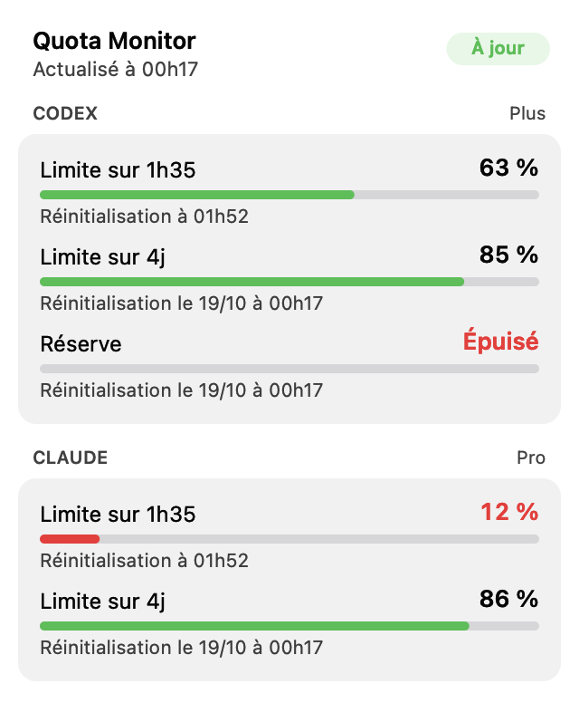
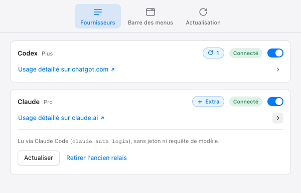

# Quota Monitor

[](https://github.com/mathiasbunnens/quota-monitor/actions/workflows/check.yml)
[](https://github.com/mathiasbunnens/quota-monitor/releases/latest)
[](docs/PLATFORMS.md)
[](src-tauri/Cargo.toml)
[](LICENSE)

**Les quotas Codex et Claude en un coup d’œil, depuis la barre des menus.**

<p>
  
  
</p>

<sub>Captures réalisées avec des données de démonstration.</sub>

Quota Monitor est une petite application de bureau pour **macOS, Windows et Linux**. Elle lit localement les limites de ton abonnement **ChatGPT (Codex)** et **Claude (Claude Code)** et affiche ce qu’il reste, sans page web ouverte ni extension.

[Télécharger la dernière version](https://github.com/mathiasbunnens/quota-monitor/releases/latest) · [Guide d’installation](docs/INSTALLATION.md) · [Compatibilité](docs/PLATFORMS.md) · [Signaler un problème](https://github.com/mathiasbunnens/quota-monitor/issues/new/choose)

## Nouveautés de la 3.0

- **Claude** rejoint Codex : limites 5 heures et hebdomadaire, abonnement (Pro, Max…) et usage supplémentaire.
- **Le menu est le tableau de bord** sur macOS : une carte par fournisseur, toutes les limites, le temps restant (« Limite sur 1h38 », « Limite sur 5j 12h ») et l’heure de réinitialisation. Il se met à jour même lorsqu’il reste ouvert.
- **Indicateur empilé** : avec les deux fournisseurs, la barre des menus affiche « Codex » et « Claude » l’un au-dessus de l’autre, sur la limite 5 heures.
- **Nouvelle fenêtre Réglages** : activation par fournisseur, état « Connecté », réinitialisations Codex en un clic (icône et nombre restant), liens vers l’usage détaillé, fenêtre ajustée à son contenu.
- Le dépôt s’appelle désormais **quota-monitor** (anciennement chatgpt-quota-monitor) ; les anciennes installations reçoivent quand même la mise à jour.

## Ce que l’application affiche

Pour chaque fournisseur activé, dans le même ordre et avec les mêmes libellés :

- la limite glissante de **5 heures**, puis la limite **hebdomadaire** ;
- le pourcentage restant, une barre verte, orange puis rouge et le temps restant avant réinitialisation ;
- pour Codex Plus, la **réserve** lorsqu’elle est réellement fournie ;
- les erreurs de lecture, visibles sur la carte concernée sans masquer l’autre fournisseur.

Une limite absente de la réponse n’est jamais inventée.

## Fonctionnement

- **Codex** : Quota Monitor démarre `codex app-server` et lit `account/rateLimits/read`. Codex réutilise la connexion ChatGPT existante ou propose de se connecter.
- **Claude** : Quota Monitor lance le CLI officiel Claude Code en mode protocole (`get_usage`), sans prompt ni requête de modèle. Connecte-toi une fois avec `claude auth login`.

Aucune extension, aucun cookie copié, aucun serveur local. La fréquence de lecture s’adapte à l’activité (ou à l’intervalle choisi) et chaque ouverture du menu déclenche une lecture immédiate.

## Installation rapide

| Système | Installation | Comportement |
| --- | --- | --- |
| macOS | Ouvre le `.dmg`, puis glisse **Quota Monitor** dans **Applications**. | Barre des menus uniquement, plus la fenêtre Réglages. |
| Windows | Lance le fichier `*-setup.exe`. | Tableau de bord et icône de notification. |
| Linux Debian/Ubuntu | `sudo apt install ./nom-du-paquet.deb` | Le tableau de bord fonctionne même sans zone de notification. |
| Linux AppImage | Rends l’AppImage exécutable, puis lance-le. | FUSE peut être nécessaire. |

Au premier lancement :

1. **Codex** : installe Codex CLI (ou l’app ChatGPT sur macOS) ; utilise **Se connecter à Codex…** si aucun compte n’est associé.
2. **Claude** : installe Claude Code, lance `claude auth login`, puis active Claude dans **Réglages → Fournisseurs**.
3. Choisis dans **Réglages → Barre des menus** ce qui s’affiche à côté de l’icône : Codex, Claude ou les deux.

Une clé API seule ne donne pas accès aux quotas d’un abonnement : connecte-toi avec le compte ChatGPT ou claude.ai concerné.

> Le paquet macOS n’est pas signé avec un certificat Apple. Si macOS bloque le premier lancement, fais un clic droit sur **Quota Monitor** dans Applications, choisis **Ouvrir**, puis confirme.

Le [guide d’installation](docs/INSTALLATION.md) détaille les chemins personnalisés, la connexion par code et le démarrage automatique sous Windows.

## Réinitialisations et usage supplémentaire

- **Codex** : le nombre de réinitialisations disponibles apparaît à côté de Codex dans les Réglages. Un clic demande confirmation, utilise une réinitialisation (sans achat) puis relit les quotas ; une réponse incertaine réutilise la même demande pour éviter une double consommation.
- **Claude** : pas de réinitialisation manuelle. L’indicateur **Extra** signale l’usage supplémentaire payant lorsqu’il est activé, géré sur claude.ai.

## Mises à jour

Quota Monitor vérifie les nouvelles versions publiées ici. Une seule fenêtre accompagne la recherche, le téléchargement, l’installation puis **Quitter et relancer**. Les artefacts de mise à jour sont signés et vérifiés.

## Confidentialité et sécurité

- aucune conversation, tâche d’agent ou requête de modèle n’est créée ;
- aucun mot de passe, cookie ou jeton n’est lu ni exposé au frontend : Codex et Claude Code gèrent eux-mêmes leur session ;
- de la réponse Claude, seuls les pourcentages, les dates de réinitialisation, l’abonnement et l’état de l’usage supplémentaire sont conservés, en mémoire ;
- aucun quota n’est envoyé vers un serveur géré par ce projet.

Voir le [rapport de sécurité](docs/SECURITY_REVIEW.md), la [politique de sécurité](SECURITY.md) et les [détails du fournisseur Claude](docs/claude-provider.md).

## Dépannage rapide

**Codex est introuvable** : installe Codex CLI ou indique le chemin de l’exécutable dans Réglages → Fournisseurs → Codex (›). Sous Windows, choisis `codex.exe`.

**Claude affiche une erreur** : vérifie `claude auth login` (compte claude.ai) et mets Claude Code à jour ; `get_usage` est un protocole expérimental testé avec Claude Code 2.1.299.

**Les quotas ne s’affichent pas** : vérifie la connexion Internet, puis rouvre le menu pour forcer une lecture.

**L’icône Linux n’apparaît pas** : certaines interfaces n’hébergent pas les AppIndicators ; le tableau de bord continue de fonctionner.

## Développement

Prérequis : Node.js 22, npm, Rust stable et les [dépendances Tauri 2](https://v2.tauri.app/start/prerequisites/).

```sh
npm ci
npm run tauri dev
```

Vérifications locales :

```sh
npm run typecheck
npm run build
cargo fmt --manifest-path src-tauri/Cargo.toml -- --check
cargo test --locked --manifest-path src-tauri/Cargo.toml
```

Rendu hors écran du vrai menu macOS (données de démonstration, clair et sombre) :

```sh
"Quota Monitor.app/Contents/MacOS/chatgpt-quota-monitor" --quota-ui-smoke /tmp/quota-ui
```

Build macOS universel :

```sh
rustup target add aarch64-apple-darwin x86_64-apple-darwin
npm run tauri build -- --target universal-apple-darwin
```

Les releases macOS, Windows et Linux sont produites par [le workflow dédié](.github/workflows/release.yml) à chaque tag `v*` ; les artefacts de l’updater nécessitent la clé de signature du projet.

## Architecture

- `src-tauri/src/codex.rs` : découverte de Codex, connexion et protocole App Server ;
- `src-tauri/src/claude.rs`, `claude_cli.rs` : fournisseur Claude et protocole Claude Code ;
- `src-tauri/src/lib.rs` : menu natif macOS, indicateur, fenêtres et mises à jour ;
- `src-tauri/src/indicator.rs`, `prefs.rs` : choix de l’indicateur et préférences ;
- `src/features/settings/` : fenêtre Réglages ; `src/pages/Dashboard/` : tableau de bord Windows/Linux.

## Contribuer

Les contributions sont bienvenues. Consulte [CONTRIBUTING.md](CONTRIBUTING.md) avant d’ouvrir une pull request.

## Licence

[MIT](LICENSE)
